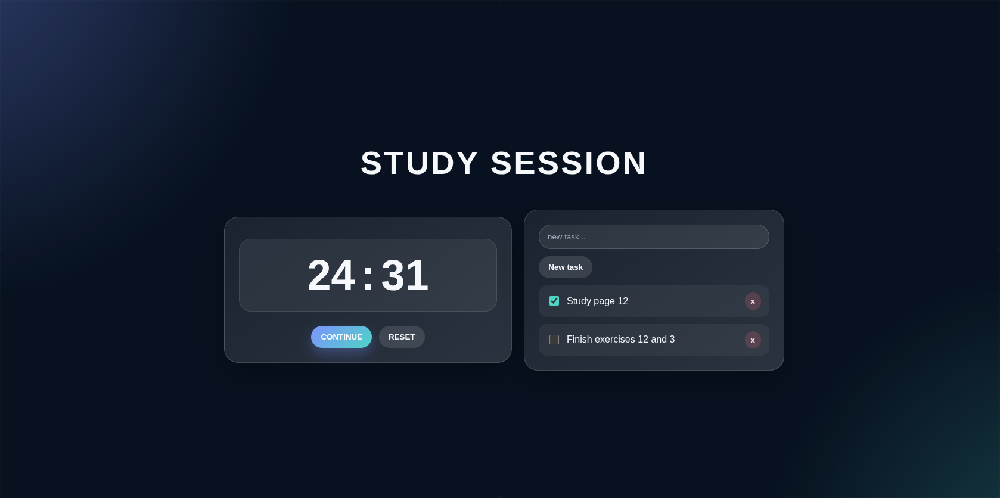

# Study App 

A clean, minimalist desktop study companion designed to boost productivity by pairing a focused **Pomodoro Timer** with an intuitive **Task Checklist** for each study session.

Built with **React** + **Vite** and packaged as a native desktop application with **Electron**. (CSS made with AI)




---

##  Features

- **Pomodoro Timer**:
  - Classic 25-minute focus intervals (`25:00`).
  - Intuitive controls: `Start`, `Stop`, and `Reset`.
  - Pause and continue anytime during a study session.
- **Study Session Checklist**:
  - Add tasks on the fly to plan out your study block.
  - Interactive checkboxes to mark progress as you complete objectives.
  - Quick-delete button (`x`) to remove completed or outdated items.
- **Desktop Native Experience**:
  - Distraction-free native window powered by **Electron**.
  - Custom app icon and hidden menubar for a clutter-free interface.
  - Preconfigured Linux packaging targets (`AppImage` and `pacman`).

---

##  Tech Stack

- **Frontend**: [React 19](https://react.dev/)
- **Bundler & Build Tool**: [Vite](https://vite.dev/)
- **Desktop Runtime**: [Electron](https://www.electronjs.org/) + [electron-builder](https://www.electron.build/)
- **Linting**: [ESLint](https://eslint.org/)

---

##  Project Structure

```text
├── build/                 # Desktop build assets & app icon (icon.png)
├── public/                # Static public assets (SVG icons, favicon)
├── src/
│   ├── assets/            # App graphic assets
│   ├── App.jsx            # Main app logic (Pomodoro & Tasks components)
│   ├── App.css            # Stylesheet for layout and widgets
│   └── main.jsx           # React entry point
├── electron.js            # Electron main process window configuration
├── index.html             # Main HTML entry file
├── package.json           # Dependencies and build scripts
└── vite.config.js         # Vite configuration (base relative paths)
```

